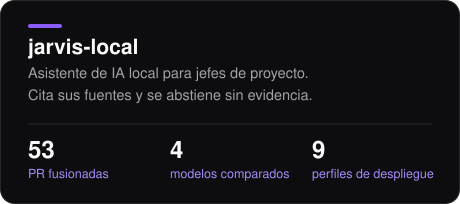
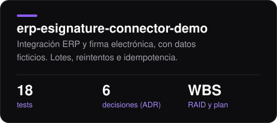
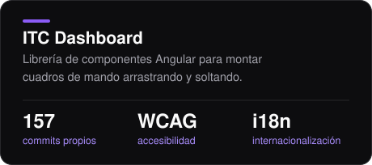
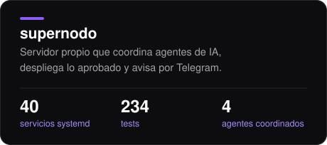
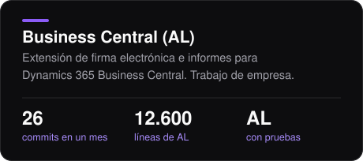
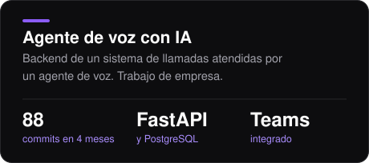
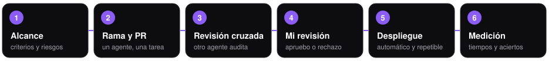

  

  
  
  
  

  

Ingeniero informático y Junior Project Manager de IT en Las Palmas de Gran Canaria. Dirijo proyectos de software y trabajo con un ecosistema de agentes de IA, MCP y modelos locales que acelera la implementación. La arquitectura, los criterios de aceptación, la revisión de cada pull request y el despliegue son míos.

## Proyectos

  
  

  
  

  
  

En [jarvis-local](https://github.com/Romen-Adama-Dev/jarvis-local) comparé cuatro modelos en una GPU de 8 GB y descarté el más rápido porque inventaba respuestas que el contexto no tenía. Las dos últimas tarjetas son trabajo de empresa, descrito sin datos internos. El caso de estudio público de `supernodo` está en preparación.

  

## Cómo trabajo

  

Cada proyecto lleva su WBS, su registro RAID, un plan con hitos y las decisiones de arquitectura escritas como ADR. El plan vivo está en OpenProject o en Plane.

## Stack

       

     

     

      

## Actividad

  

## Contacto

  
  

Español nativo. Inglés B2, preparando el C1.

---

English

Computer engineer (ULPGC, 2025) and junior IT project manager. My master's thesis in project management is an AI assistant that runs entirely on a self-hosted server.

I work with an ecosystem of AI agents (Claude Code, Codex and local models on Ollama) connected through MCP and a private Tailscale network. It lets me deliver faster while I keep control: I define the architecture and acceptance criteria, review every pull request and handle deployment.

Current work: [jarvis-local](https://github.com/Romen-Adama-Dev/jarvis-local), a local RAG assistant for project managers that cites its sources, abstains without evidence and manages OpenProject from Telegram. Before picking a model I benchmarked four on an 8 GB GPU and dropped the fastest one because it made up answers. Also: [erp-esignature-connector-demo](https://github.com/Romen-Adama-Dev/erp-esignature-connector-demo), an ERP to e-signature connector with fictional data, tests and its project artifacts (WBS, RAID log, plan, ADRs). Coming soon: a case study on running a self-hosted server as the hub for coding agents.

